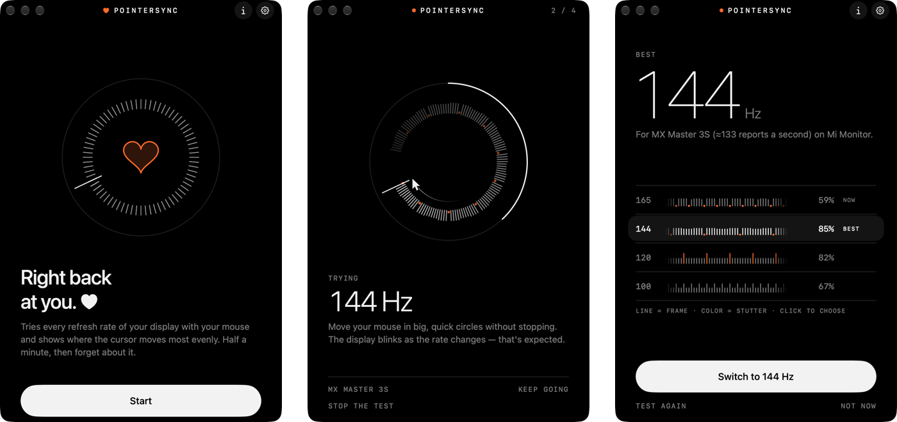

<p align="center"></p>

<h1 align="center">PointerSync</h1>

<p align="center">Makes your mouse cursor move as evenly as your display allows,<br>by matching the display's refresh rate to your mouse. Set it once and forget it.</p>

<p align="center">
  <a href="https://github.com/ElowriT/pointersync/releases/latest/download/PointerSync.dmg"></a>
  <a href="https://elo7151.gumroad.com/l/pointersync"></a>
</p>

<p align="center"><a href="https://ko-fi.com/elo7151"></a></p>

<p align="center"><a href="README.ru.md">Русский</a></p>

<p align="center"></p>

## Why the cursor stutters

Your mouse reports how far it moved many times a second; a Bluetooth mouse, about 133 times. Your display draws frames at its own rate: 120, 144, 165 times a second. When the two don't line up, the cursor stands still in some frames and jumps two steps in others, so it stutters even though your hand moves smoothly. A Bluetooth mouse on a 165 Hz display leaves every fifth frame without any movement.

Some refresh rates simply fit your mouse better. PointerSync finds yours.

## How it works

Open PointerSync and move your mouse in big, quick circles. It switches your display through each refresh rate from 90 Hz up and, at every rate, watches where the cursor lands in each frame. The display blinks as it switches; that's expected. Then it shows how evenly the cursor moved at each rate, frame by frame, and suggests the best one. You pick and confirm, and if you don't confirm within 15 seconds, everything goes back the way it was.

That's all. The refresh rate stays in macOS's settings, and you never need to open PointerSync again.

- **No permissions, nothing in the background.** PointerSync only changes your display's refresh rate. You can change it back any time in System Settings → Displays.
- **Nothing between your mouse and the cursor.** No input hooks, no smoothing.
- **Stop any time** with Esc: the display goes back to its rate.

## Requirements

- A Mac with Apple silicon and macOS 26 or later.
- A display that offers several refresh rates. Most high refresh rate external monitors do.

## Install

1. Download [PointerSync.dmg](https://github.com/ElowriT/pointersync/releases/latest/download/PointerSync.dmg), open it and drag PointerSync into Applications.
2. Open PointerSync. The first time, macOS stops it: PointerSync isn't notarized by Apple, which takes a paid developer account. Click **Done**.
3. Open **System Settings → Privacy & Security** and scroll down to **Security**. Next to the line saying PointerSync was blocked, click **Open Anyway**, confirm with your password or Touch ID, and click **Open Anyway** once more. The button shows up for about an hour after you tried to open the app.

You only do this once; after that PointerSync opens like any other app. All its code is here, so you can also [build it yourself](#build-it-yourself).

<details>
<summary>Or with one command in Terminal</summary>

```bash
xattr -dr com.apple.quarantine /Applications/PointerSync.app
```

It removes the "downloaded from the internet" mark from the app, so macOS doesn't stop it.

</details>

## Build it yourself

You need Xcode 26.

```bash
git clone https://github.com/ElowriT/pointersync.git
cd pointersync
./build.sh
open ~/Library/Developer/PointerSync/PointerSync.app
```

How it works inside, how it measures and how releases are made (in Russian): [docs/DEVELOPMENT.ru.md](docs/DEVELOPMENT.ru.md).

## Support

PointerSync is free. If it helped, you can buy me a coffee on [Ko-fi](https://ko-fi.com/elo7151).

## Licence

PointerSync (everything in this repository) is © 2026 ElowriT and is licensed under the GNU General
Public License, version 3: see [LICENSE](LICENSE).
