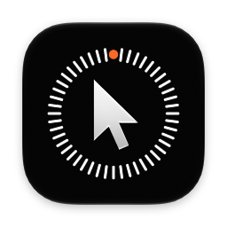
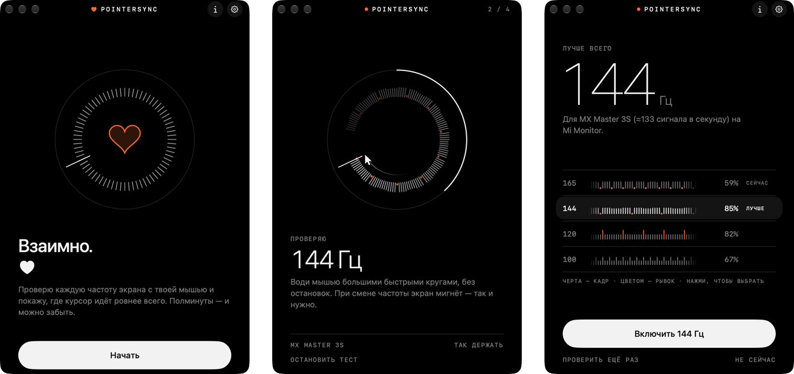

<p align="center"></p>

<h1 align="center">PointerSync</h1>

<p align="center">Подбирает частоту экрана под твою мышь, чтобы курсор шёл так ровно,<br>как только позволяет экран. Настроил один раз — и забыл.</p>

<p align="center">
  <a href="https://github.com/ElowriT/pointersync/releases/latest/download/PointerSync.dmg"></a>
  <a href="https://elo7151.gumroad.com/l/pointersync"></a>
</p>

<p align="center"><a href="https://ko-fi.com/elo7151"></a></p>

<p align="center"><a href="README.md">English</a></p>

<p align="center"></p>

## Откуда рывки

Мышь сообщает, куда сдвинулась, много раз в секунду: Bluetooth-мышь — около 133 раз. Экран рисует кадры со своей частотой: 120, 144, 165 раз в секунду. Когда частоты не совпадают, в одних кадрах курсор стоит, а в других прыгает сразу на два шага — получаются рывки, хотя рука движется плавно. У Bluetooth-мыши на экране 165 Гц без движения остаётся каждый пятый кадр.

Некоторые частоты просто лучше подходят к твоей мыши. PointerSync находит такую.

## Как это работает

Открываешь PointerSync и водишь мышью большими быстрыми кругами. Он по очереди включает каждую частоту экрана от 90 Гц и на каждой смотрит, где курсор оказывается в каждом кадре. При переключении экран мигает — так и нужно. Потом показывает, насколько ровно курсор шёл на каждой частоте, кадр за кадром, и советует лучшую. Ты выбираешь и подтверждаешь, а если не подтвердить за 15 секунд, всё вернётся как было.

На этом всё: частота остаётся в настройках macOS, и PointerSync больше можно не открывать.

- **Никаких разрешений и ничего в фоне.** PointerSync меняет только частоту экрана, вернуть её можно в любой момент в Системных настройках → Дисплеи.
- **Между мышью и курсором ничего не встаёт.** Ни перехвата, ни сглаживания.
- **Остановить можно в любой момент** клавишей Esc: экран вернётся на свою частоту.

## Что нужно

- Мак на Apple silicon с macOS 26 или новее.
- Экран с несколькими частотами. Таких большинство внешних мониторов с высокой частотой.

## Установка

1. Скачай [PointerSync.dmg](https://github.com/ElowriT/pointersync/releases/latest/download/PointerSync.dmg), открой его и перетащи PointerSync в «Программы».
2. Запусти PointerSync. В первый раз macOS его остановит: приложение не заверено Apple, для этого нужен платный аккаунт разработчика. Нажми **«Готово»**.
3. Открой **Системные настройки → Конфиденциальность и безопасность** и пролистай вниз до раздела **«Безопасность»**. Рядом со строкой о том, что PointerSync заблокирован, нажми **«Всё равно открыть»**, подтверди паролем или Touch ID и ещё раз нажми **«Всё равно открыть»**. Кнопка видна примерно час после попытки запуска.

Это нужно сделать один раз, дальше PointerSync открывается как обычное приложение. Весь его код лежит здесь, так что его можно и [собрать самому](#собрать-самому).

<details>
<summary>Или одной командой в Терминале</summary>

```bash
xattr -dr com.apple.quarantine /Applications/PointerSync.app
```

Команда снимает с приложения пометку «скачано из интернета», и macOS его больше не останавливает.

</details>

## Собрать самому

Нужен Xcode 26.

```bash
git clone https://github.com/ElowriT/pointersync.git
cd pointersync
./build.sh
open ~/Library/Developer/PointerSync/PointerSync.app
```

Как всё устроено внутри, как идёт замер и как собирается релиз: [docs/DEVELOPMENT.ru.md](docs/DEVELOPMENT.ru.md).

## Поддержать

PointerSync бесплатный. Если помог — можно угостить меня кофе на [Ko-fi](https://ko-fi.com/elo7151).

## Лицензия

PointerSync (всё в этом репозитории) — © 2026 ElowriT, распространяется по лицензии GNU General
Public License версии 3: см. [LICENSE](LICENSE).
